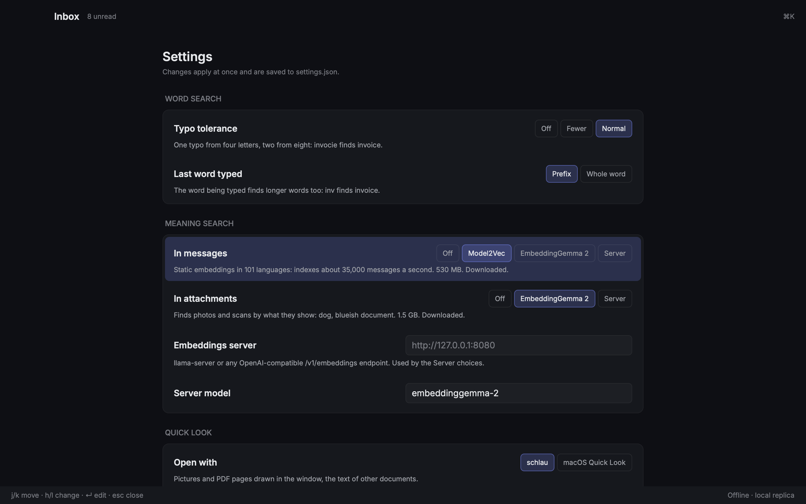

# schlau

A fast, keyboard-first mail client for Fastmail and any JMAP server, built on
[rune](https://github.com/anomalyco/rune). Everything you see comes from a local SQLite replica, so the UI never
waits on the network.

## Run

```sh
cargo run -p schlau-app --release -- --demo                # 20k synthetic messages, no account
cargo run -p schlau-app --release -- --demo --demo-size 100000
FASTMAIL_API_TOKEN=fmu1-… cargo run -p schlau-app --release  # your Fastmail account
cargo run -p schlau-app --release -- --fixtures fixtures/mailbox --index-attachments  # the fixture mailbox
```

Create a token under Fastmail → Settings → Privacy & Security → API tokens (mail access). Other JMAP servers:
set `JMAP_SESSION_URL` and `JMAP_TOKEN`. On macOS the token can live in the Keychain instead:

```sh
security add-generic-password -s schlau -a fastmail -w fmu1-…
```

Data lives in `~/Library/Application Support/schlau/` (`mail.sqlite`, `demo.sqlite`, `models/`). `--db PATH` uses
another database.

### macOS app

```sh
scripts/bundle-macos.sh            # target/release/bundle/schlau.app
scripts/bundle-macos.sh --install  # and copies it to ~/Applications
```

An app opened from Finder or the Dock doesn't see your shell's environment, so keep the token in the Keychain (above).
The icon is `assets/icon/schlau.icns`, made from the artwork in `assets/icon/schlau-fuchs.png` by
`uv run scripts/app-icon.py`.

## Keys

| Key | Action |
|---|---|
| `⌘K` | Command palette (every command, every mailbox) |
| `/` | Search |
| `j` / `k`, `↓` / `↑` | In the list: next / previous conversation. In an open one: scroll down / up |
| `⇧J` / `⇧K` | Next / previous conversation, from anywhere |
| `n` / `p` | Next / previous message in the open conversation |
| `⌃D` / `⌃U` | Half a page down / up (ten rows in the list) |
| `⌃F` / `⌃B`, `PgDn` / `PgUp` | A page down / up (twenty rows in the list) |
| `g g` / `⇧G`, `Home` / `End` | Top / bottom of the conversation, or the newest / oldest loaded one in the list |
| `↵`, `o`, `l` or `→` | Open |
| `esc`, `u`, `h` or `←` | Back |
| `g f` or `g l` | Go to folder (fuzzy, every folder with its unread count) |
| `⌘,` | Settings |
| `space` | Quick look at the message's attachments (`←`/`→` between them, `↵` opens in the default app, `space` closes) |
| `e` | Done (archive) |
| `#` | Trash |
| `!` | Spam |
| `s` | Star |
| `⇧U` / `⇧I` | Mark unread / read |
| `z` | Undo the last action |
| `i` | Load the images in the open conversation |
| `v` | View the original HTML in the secure web view |
| `⇧E` | Expand or collapse all messages |
| `g i`, `g e`, `g t`, `g d`, `g #`, `g !` | Go to Inbox, Archive, Sent, Drafts, Trash, Spam |
| `⌘R` | Sync now |

## Search

Words are typo-tolerant (`invocie` finds "invoice", `shcema` finds "schema") and the last word matches as a prefix
while you type. Operators: `from:` `to:` `cc:` `subject:` `body:` `filename:`, `in:inbox` / `label:x`,
`is:unread|read|starred|draft|answered`, `has:attachment`, `after:` / `before:` / `newer_than:7d` /
`older_than:1y`, `larger:5M` / `smaller:100k`, `"exact phrases"`, `-negation`, `a OR b`, `{a b}`.

Meaning search (the "Meaning search in messages" setting) adds local embeddings, Model2Vec
(potion-multilingual-128M, 101 languages) or EmbeddingGemma 2: "where we talked about the offsite budget" finds the thread
even without those words. Word and meaning hits are fused the way DigUp does it: a message's meaning score is how far
it stands out from the query's distribution, and exact words still win lookups like invoice numbers.

## Settings

`⌘,` (or "Settings" in the `⌘K` palette) opens the settings pane: `j`/`k` move between settings, `h`/`l` change
the choice (or click it), `↵` edits the server fields and saves them, `esc` closes. Changes apply at once and are kept
in `settings.json` next to the database.



| Section | Setting | Choices |
|---|---|---|
| Word search | Typo tolerance | Off · Fewer (one typo, words of 6+ letters) · Normal (one typo from 4 letters, two from 8) |
| | Last word typed | Prefix while typing · Whole word |
| Meaning search | In messages | Off · Model2Vec (530 MB) · EmbeddingGemma 2 (1.5 GB) · Server |
| | In attachments | Off (their words stay searchable) · EmbeddingGemma 2 · Server |
| | Embeddings server, server model | Any OpenAI-compatible `/v1/embeddings` endpoint, such as llama-server |
| Quick look | Open with | schlau · macOS Quick Look |

Choosing a model downloads it if needed and indexes in the background. Vectors are kept per model, so switching
back is instant. Without a settings file, search uses whatever models are already downloaded. Choosing Server before
a server is set asks for its address and applies once it is saved. `SCHLAU_EMBED_URL` sets a server for one run
without saving, and points attachment search at it.

```json
{
  "search": { "typos": "normal", "last_word": "prefix", "text_meaning": "model2vec", "attachment_meaning": "embedding-gemma" },
  "preview": "schlau"
}
```

## Quick look

`space` previews the open message's attachments in one of two viewers (the "Quick look with" setting):

- **schlau's viewer** (default): photos and PDF pages drawn in the window by the same pure-Rust code that indexes
  them, documents as text. Nothing else ever parses the file.
- **macOS Quick Look**: the system panel, for everything macOS can preview (HEIC, Office, iWork, video, audio).
  The panel doesn't take the keyboard, so `space`/`esc` close it and `←`/`→` step through the files as in Finder.

Either way the file is fetched once into `attachments/` next to the database, and `↵` opens it in the default app.

## Image and attachment search

Attachments are indexed in the background: text from PDFs (text layer), Word, PowerPoint, Excel, OpenDocument,
calendar invites and text files joins the word index, so `nachzahlung` finds the German PDF. With the multimodal
model, photos and page images are embedded too, so "dog" finds the beach photos and "blueish document" finds a
scanned agenda; the search panel shows which file matched.

The model is EmbeddingGemma 2 (Apache 2.0): text, images and audio in one 768-dim space. Two ways to run it:

- **Built in** (default): a pure-Rust implementation on candle (`crates/schlau-gemma`), Metal on Apple Silicon.
  Choose it in the "Meaning search in attachments" setting, a one-time 1.5 GB download. About 290 ms per image
  and 17 ms per query on an M4 Pro. The query side keeps only the text tower loaded; the vision tower loads while
  there are attachments to index and unloads a minute after.
- **A server you already run**: anything that speaks OpenAI `/v1/embeddings`. With llama.cpp:

  ```sh
  llama-server -m embeddinggemma-2-Q8_0.gguf --mmproj mmproj-embeddinggemma-2-Q8_0.gguf \
    --embeddings --pooling mean --image-max-tokens 140 -c 4096 -ub 2048 -b 2048 --port 8080
  SCHLAU_EMBED_URL=http://127.0.0.1:8080 cargo run -p schlau-app --release
  ```

  or put it in `settings.json` (see Settings) and choose "embeddings server".

  (`ggml-org/embeddinggemma-2-GGUF`; `SCHLAU_EMBED_MODEL` and `SCHLAU_EMBED_KEY` for other servers.) At 140 image
  tokens its vectors match the built-in model's to a cosine of 0.9996, so switching keeps the index.

## Privacy

Message HTML never reaches a renderer unsanitized. The reader draws its own blocks; the web view (`v`) is a
WKWebView with JavaScript off, a non-persistent store, a CSP that allows no remote loads, and a WebKit rule list that
blocks every http(s) request as a second line. Tracking pixels are removed, remote images are blocked, link wrappers
(Google, Outlook safelinks, Proofpoint, Mandrill, …) are unwrapped and `utm_*`-style parameters stripped; the reader
says what it removed.

A blocked image shows as a block with its description (alt text) and the host it would come from. Click it to load
that one, or press `i` (or "Load images" in the reader's privacy line) for every image in the open conversation.
Loading tells the sender's server that the message was opened, and from which address, so nothing loads by itself.
Images are fetched by schlau, not a browser: no cookies, no referrer, https first, 15 MB at most, decoded off the main
thread and kept for the session. Tracking pixels are never loaded, whatever you choose.

## Layout

See [ARCHITECTURE.md](ARCHITECTURE.md).

```sh
cargo test --workspace
cargo clippy --workspace --all-targets
SCHLAU_TEST_DB=path/to/demo.sqlite cargo test --release -p schlau-app keystroke_latency -- --ignored --nocapture
cargo test --release -p schlau-sync --features metal --test attachments   # image search, with the model downloaded
FASTMAIL_API_TOKEN=… cargo run --release -p schlau-sync --example sync -- /tmp/live.sqlite 2 10  # live sync smoke test
```
